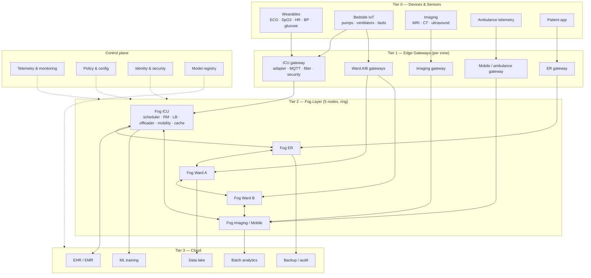

# MobiCare-Fog — Architecture, Layer Flow and Workflow

This document tells you exactly what the system architecture diagram must contain, how the
layers interact, what each component does, and how the implementation was built.

The simulation realises Tier 2 in full and models Tiers 0, 1 and 3 at the level needed for
evaluation (task generation, links, and cloud execution).

---

## 1. What the architecture diagram must contain

Draw **three horizontal tiers** stacked bottom-to-top: devices → edge → fog → cloud. Add a
vertical **control plane** panel on the right with dashed connections to the fog layer. Add a
legend for the four workload classes and the link types.

### Tier 0 — Devices and sensors (bottom band)

Group the boxes into:

| Box | Contents |
|---|---|
| Wearables | ECG patch, SpO2, heart rate, blood pressure, glucose, accelerometer |
| Bedside IoT | infusion pumps, ventilators, bed-occupancy sensors, nurse call |
| Imaging | MRI, CT, ultrasound (large files) |
| Ambulance / mobile | mobile telemetry, GPS, in-vehicle gateway |
| Patient app | symptom reporting, alerts |

Draw a dashed arrow from the ambulance box to the mobility manager in the fog layer labelled
"patient mobility".

### Tier 1 — Edge gateways (band above devices)

Draw **one gateway per zone**: ICU, Emergency, Ward A, Ward B, Imaging/Ambulance. Each
gateway box contains four sub-boxes:

1. **Protocol adapter** — BLE / Zigbee / Wi-Fi / wired.
2. **MQTT broker / stream ingest** — normalises and publishes measurements.
3. **Filter & aggregator** — noise removal, windowing, compression, local cache.
4. **Security agent** — authentication, encryption, consent check.

Connect devices to gateways with thin arrows labelled `BLE / Zigbee / Wi-Fi`.
Label the gateway output `MQTT / TLS over LAN or 5G`.

### Tier 2 — Fog layer (band above gateways)

Draw **5 fog nodes in a ring** (one per zone). Every fog node contains these sub-components:

1. **Task Scheduler** — admission control, class detection, critical-first EDF queue.
2. **Resource Manager** — live CPU, memory, queue-length and residual-energy view.
3. **Load Balancer** — round-robin / least-loaded / weighted score.
4. **Offloading Decision Engine** — chooses local fog, neighbour fog, or cloud.
5. **Mobility Manager** — handoff tracking, context prefetch, state migration.
6. **Local analytics / inference** — ECG arrhythmia detection, alert triage, SpO2 rules.
7. **Patient-context cache** — recent vitals, history, session state.
8. **Energy monitor** — power draw per node.

Connect gateways to fog nodes with arrows labelled `400 Mbps, 2 ms`.
Connect fog nodes to each other in a ring with bidirectional arrows labelled
`1 Gbps, 3 ms` and `neighbour offload / context migration`.

### Tier 3 — Cloud (top band)

Boxes:

- EHR / EMR store
- Data lake (historical vitals, imaging archive)
- Batch analytics (Spark)
- ML model training
- Backup / audit
- Global monitoring dashboard

Connect the fog ring to cloud with arrows labelled `WAN 200 Mbps, 40 ms`, annotated
`imaging, batch, EHR sync, model updates`.

### Control plane (right-hand vertical panel, dashed arrows)

- Telemetry & monitoring
- Policy / configuration (weights, deadlines, thresholds)
- Identity & access management
- Model registry / updates

Dashed arrows go to the fog layer and to the cloud.

### Legend

| Class | Example | Deadline | Typical placement |
|---|---|---|---|
| Critical | arrhythmia alert, SpO2 drop | 50 ms | local fog |
| Interactive | vitals dashboard, consult | 300 ms | local / neighbour fog |
| Imaging | CT/MRI analytics | 20 s | cloud (or fog if bandwidth allows) |
| Batch | EHR sync, retraining | 120 s | cloud |

Also mark the decision rule on the diagram if space allows:

```
score = 0.45·(latency/50ms) + 0.20·(energy/50J) + 0.25·(queue/0.5s) + 0.10·(mobility/50ms)
subject to: estimated_latency ≤ 0.9 × deadline
```

### Reference Mermaid version

Paste this into <https://mermaid.live> if you want a quick editable draft:



---

## 2. Layer-by-layer flow table

| Layer | Component | Role |
|---|---|---|
| Tier 0 | Wearable sensors | Continuously sample ECG, SpO2, HR, BP and glucose; emit small periodic messages. |
| Tier 0 | Bedside / hospital IoT | Emit infusion, ventilation and occupancy events; some are alarm-grade. |
| Tier 0 | Imaging devices | Produce large DICOM studies (tens of MB); latency-tolerant but bandwidth-heavy. |
| Tier 0 | Ambulance telemetry | Mobile source; changes network attachment as the vehicle moves. |
| Tier 0 | Patient app | Submits symptoms and receives alerts; interactive traffic. |
| Tier 1 | Protocol adapter | Converts BLE/Zigbee/Wi-Fi/wired frames into a common message format. |
| Tier 1 | MQTT broker / ingest | Buffers, orders and publishes measurements to the correct fog node. |
| Tier 1 | Filter & aggregator | Removes noise, windows signals, compresses payloads and caches recent samples. |
| Tier 1 | Security agent | Authenticates devices, encrypts in transit, enforces consent and access policy. |
| Tier 2 | Task Scheduler | Classifies each task, applies admission control, and queues work critical-first (EDF). |
| Tier 2 | Resource Manager | Tracks per-node CPU load, pending cycles, queue delay, memory and energy; feeds estimates. |
| Tier 2 | Load Balancer | Selects among candidate nodes using round-robin, least-loaded, lowest-latency or weighted score. |
| Tier 2 | Offloading Decision Engine | Estimates latency and energy per candidate; enforces the deadline constraint; chooses local fog, neighbour fog or cloud. |
| Tier 2 | Mobility Manager | Detects zone changes, transfers/prefetches patient context, and limits handoff interruption. |
| Tier 2 | Local analytics | Runs lightweight inference and rule engines (arrhythmia, desaturation) close to the patient. |
| Tier 2 | Patient-context cache | Keeps recent vitals and session state so care can continue after a handoff. |
| Tier 2 | Energy monitor | Measures node power draw and exposes energy per task and per node. |
| Tier 2 | Execution workers | Run admitted tasks on node cores and report completion, queue delay and busy time. |
| Tier 3 | EHR / EMR | System of record for long-term patient data. |
| Tier 3 | Data lake | Stores historical signals and imaging for retrospective analysis. |
| Tier 3 | Batch analytics | Runs Spark/Hadoop jobs over historical data. |
| Tier 3 | ML training | Trains and updates clinical models that are pushed back to fog nodes. |
| Tier 3 | Backup / audit | Ensures durability, compliance and traceability. |
| Cross-cutting | Telemetry & monitoring | Collects metrics from all tiers for dashboards and evaluation. |
| Cross-cutting | Policy & configuration | Holds scheduling weights, deadlines, thresholds and experiment parameters. |
| Cross-cutting | Identity & security | Provides authentication, authorisation and audit across tiers. |

---

## 3. End-to-end task lifecycle (what happens to one measurement)

1. **Sense** — a wearable or device produces a sample and sends it to its zone gateway.
2. **Ingest** — the gateway filters, aggregates, timestamps and forwards the task.
3. **Classify** — the fog scheduler labels it critical / interactive / imaging / batch from
   its source and payload metadata.
4. **Estimate** — the resource manager computes, for each candidate node:
   `latency = edge processing + serialisation + propagation + link backlog + node queue + execution`
   and `energy = execution power + transmission energy`.
5. **Constrain and score** — candidates whose estimated latency exceeds `0.9 × deadline` are
   dropped when a feasible candidate exists. The rest are scored with the weighted formula.
6. **Place** — local fog, neighbour fog, or cloud is selected. Proposed policy uses the
   weighted score; baselines use round-robin, least-loaded or lowest-latency.
7. **Transmit** — the task crosses serialised links; propagation delay overlaps with other
   traffic; transmission energy is charged to the task.
8. **Queue** — the destination node inserts the task into a priority store: EDF for proposed /
   latency-aware, FCFS for the other baselines.
9. **Execute** — a worker on one core executes `cycles / node_speed` and updates pending load,
   busy time and completion status.
10. **Check deadline** — completion time is compared with arrival + deadline; the task is
    marked met or missed.
11. **Feedback** — the resource manager sees the freed capacity; metrics are recorded.
12. **Mobility** — if the patient changes zone, the mobility manager starts context transfer;
    with prefetch only 10% of the transfer time blocks new tasks.
13. **Aggregate** — after the warm-up period, metrics are computed over the measurement window
    and written to CSV for figures and the dashboard.

---

## 4. What we have built so far — step by step

| Stage | Commit | What was added | Why it matters |
|---|---|---|---|
| 1. Scaffold | `87a1c6c` | Git repo, venv, config schema, YAML parameters, GitHub remote | Reproducible base and single source of truth for experiments |
| 2. Core model | `218d096` | `Task`, `ComputeNode`, `Patient`, `Link`, `Topology`, energy model, unit tests | Represents the three-tier topology, link delays and power draw |
| 3. Workload & mobility | `f9e28d9` | Poisson four-class workload, random-waypoint patients, handoff/prefetch | Creates realistic load and measures mobility support |
| 4. Orchestration | `ef3c647` | Resource manager, load balancer, task scheduler, five placement policies | Implements the brain of the framework: scheduling, balancing, offloading |
| 5. Simulator & metrics | `23cc1ef` | SimPy engine, EDF/FCFS workers, link backlog, metric aggregation, calibration | Produces all evaluation numbers used in the report |

Validation already performed:

- All placement policies run and produce complete metric sets.
- Simulation is deterministic for a fixed seed.
- Cloud-only puts 100% of tasks in the cloud; proposed keeps critical traffic on fog.
- Stress testing exposed and fixed a modelling bug where WAN propagation was incorrectly
  occupying a bandwidth slot (it capped throughput and inflated latency).

### How to run it now

```powershell
cd C:\Users\prano\fog-healthcare
.\.venv\Scripts\python.exe -m pytest -q

$env:PYTHONPATH="src"
.\.venv\Scripts\python.exe -c "from fogsim import FogSimulation, load_config; cfg=load_config(overrides={'algorithm':{'name':'proposed'}}); s=FogSimulation(cfg).run(); print({k:round(v,3) for k,v in s.items() if isinstance(v,(int,float))})"
```

The dashboard command will be:

```powershell
cd C:\Users\prano\fog-healthcare
.\.venv\Scripts\streamlit.exe run dashboard/app.py --server.port 8501
```

Then open <http://localhost:8501>, interact with the sidebar, and take screenshots with
`Win + Shift + S` (or the Snipping Tool). Stop the server with `Ctrl + C`.

---

## 5. Evaluation mapping

| Metric | Definition | Where it is measured |
|---|---|---|
| Response time | completion time − arrival time | task records |
| Latency (network) | serialisation + propagation + link backlog | per-link path |
| Queue delay | execution start − node arrival | node worker |
| Energy | node idle + dynamic power + transmission energy | node energy + task energy |
| Resource utilisation | busy core-time / (cores × window) | node busy time |
| Task completion rate (TCR) | tasks meeting deadline / tasks arrived | metrics collector |
| Workload distribution | share of completed tasks on fog vs cloud | task tier |
| Load balance | Jain fairness index over per-node completions | task counts |
| Scalability | metrics vs patient count / fog count | experiment sweeps |
| Mobility | handoffs, handoff success, migration blocking time | mobility manager |

---

## 6. Simulated vs conceptual layers

| Layer | In the real architecture | In the simulation |
|---|---|---|
| Tier 0 | Physical sensors with radio stacks | Poisson task streams per patient and class |
| Tier 1 | Gateways with filtering and MQTT | 1 ms edge processing + 400 Mbps / 2 ms edge link |
| Tier 2 | MEC servers and orchestrators | 5 fog nodes, 8 cores, 5000 Mcycles/s, full scheduler/RM/LB/mobility |
| Tier 3 | Cloud data centre | 64 cores, 100,000 Mcycles/s, 200 Mbps / 40 ms WAN |
| Control plane | Telemetry, policy, security | Resource manager, metrics collector, YAML config |

This distinction should be stated explicitly in the report: the results are comparative
discrete-event simulation results, not measurements from a deployed testbed.
